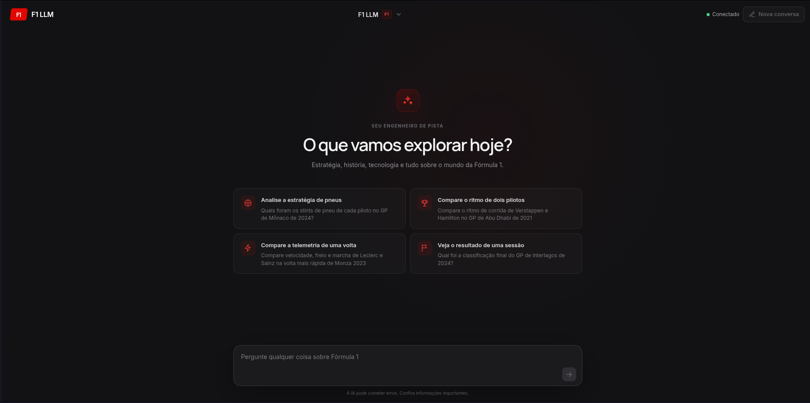

<h1 align="center">f1-llm</h1>

<p align="center">
  Chatbot que responde perguntas em linguagem natural sobre Fórmula 1 e plota gráficos,<br>
  usando dados oficiais de cronometragem via FastF1.
</p>

<p align="center">
  <a href="https://github.com/ThallesNonato1123/f1-llm/actions/workflows/ci.yml">
    
  </a>
  
  
</p>

<p align="center">
  
</p>

---

Você pergunta *"compara o ritmo de corrida do Verstappen e do Norris em Interlagos 2024"*. O modelo escolhe qual ferramenta de dados chamar e com quais parâmetros, a ferramenta lê os dados oficiais da sessão, e a resposta volta em texto com um gráfico interativo ao lado.

Este README descreve **como o projeto é construído**: a stack, a arquitetura e as decisões que moldaram o código.

## Stack

| Camada | Escolha | Papel |
|---|---|---|
| Linguagem | **Python 3.14** | Gerenciado pelo [uv](https://docs.astral.sh/uv/) (`.python-version` + `uv.lock`) |
| Dados | **[FastF1](https://docs.fastf1.dev/)** | Cronometragem, telemetria, pneus e classificações oficiais da F1 |
| LLM | **[Claude](https://docs.claude.com/)** (`anthropic`) | Interpreta a pergunta e decide as chamadas de ferramenta |
| Backend | **[FastAPI](https://fastapi.tiangolo.com/)** + uvicorn | `POST /chat`, `GET /health`, serve o build do frontend |
| Frontend | **React + Vite + Tailwind CSS** | Node 22 + pnpm, builda para `frontend/dist/` ([ADR 0006](docs/adr/0006-react-vite-frontend.md)) |
| Gráficos | **Plotly** | Montados como JSON no backend, renderizados pelo `plotly.js` no navegador |
| Testes | **pytest** | 170 testes: 149 rápidos + 21 de integração |

Build backend: `uv_build`.

## Arquitetura

```
  navegador                backend FastAPI                  fora do processo
 ┌───────────┐    POST    ┌──────────────┐   tool calling   ┌──────────────┐
 │ index.html│  /chat ──> │ llm/chat.py  │ <──────────────> │  Claude API  │
 │ plotly.js │ <── JSON   └──────┬───────┘                  └──────────────┘
 └───────────┘ texto +          │ chama a ferramenta escolhida
               gráficos         ▼
                         ┌──────────────┐                   ┌──────────────┐
                         │  tools/*.py  │ ────────────────> │    FastF1    │
                         └──────────────┘    load_*(...)    └──────────────┘
```

```
src/f1llm/
├── api/app.py          FastAPI: POST /chat, GET /health, serve frontend/dist por último
├── llm/
│   ├── chat.py         loop de tool calling + system prompt
│   ├── tools.py        schemas das 17 ferramentas expostas ao modelo
│   └── production.py   wiring da API da Anthropic (modelo, effort, max_tokens)
├── tools/              uma ferramenta por arquivo: dados + gráfico
├── fastf1_client.py    a fronteira: a única coisa que fala com a FastF1
├── charts.py           tema escuro compartilhado dos gráficos
└── errors.py           SessionDataUnavailable

frontend/               React + Vite + Tailwind CSS, toolchain própria (Node 22, pnpm)
```

## Decisões arquiteturais

- [0001 — Arquitetura do app web: backend FastAPI, gráficos via Plotly](docs/adr/0001-web-app-architecture.md)
- [0002 — Backend stateless, histórico da conversa no frontend](docs/adr/0002-stateless-backend-conversation-history.md)
- [0003 — LLM via API cloud com tool calling](docs/adr/0003-cloud-llm-tool-calling.md)
- [0004 — Plotly em vez do matplotlib nativo da FastF1](docs/adr/0004-plotly-over-matplotlib.md)
- [0005 — Correção por combustível e filtro de volta limpa na degradação de pneu](docs/adr/0005-tyre-degradation-data-model.md)
- [0006 — Frontend em React + Vite + Tailwind CSS, com build step](docs/adr/0006-react-vite-frontend.md)
- [0007 — Aceleração derivada da telemetria por diferenciação suave, não medida direto](docs/adr/0007-gg-diagram-acceleration-model.md)

## Rodando

```bash
uv sync
cp .env.example .env    # preencha ANTHROPIC_API_KEY

cd frontend && pnpm install && pnpm build && cd .. # gera frontend/dist/, servido pelo FastAPI em "/"

uv run uvicorn f1llm.api.app:app --reload           # app web em :8000
uv run f1llm-chat                                   # chat no terminal
uv run f1llm-preview stints 2024 Brazil Race        # um gráfico só, sem LLM

uv run pytest                                       # suíte rápida, sem rede
uv run pytest -m integration -v                     # dados reais da FastF1
```

`F1LLM_MODEL` (padrão `claude-opus-5`) e `F1LLM_EFFORT` (padrão `medium`) trocam o modelo e o esforço de raciocínio. Ambas podem ir no mesmo `.env`.

Em desenvolvimento, use `pnpm dev` dentro de `frontend/` para hot reload em `http://localhost:5173` (com proxy pra `/chat` e `/health` no FastAPI) em vez de `pnpm build`.

### Docker

```bash
cp .env.example .env    # preencha ANTHROPIC_API_KEY
docker compose up --build
```

Sobe o backend FastAPI (com o frontend já buildado dentro da imagem) em `http://localhost:8000`. O cache da FastF1 persiste num volume nomeado entre execuções.
